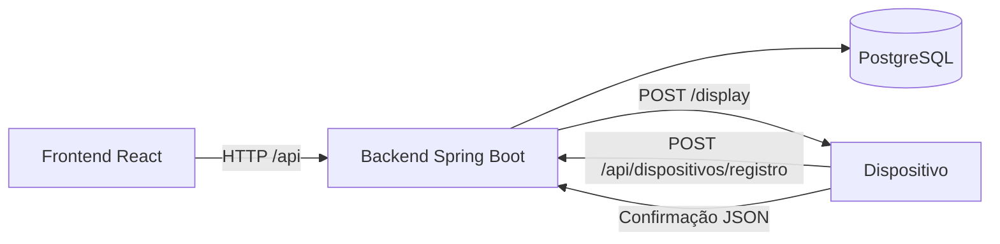

# ESL Manager

Sistema para gerenciar etiquetas eletrônicas de prateleira (Electronic Shelf
Labels), associar produtos e enviar nome, código de barras e preço aos
dispositivos pela rede local.

O repositório reúne uma interface React, uma API Spring Boot e persistência em
PostgreSQL. A confirmação de atualização depende da resposta do dispositivo.

## Funcionalidades

- Painel com totais de etiquetas disponíveis e associadas.
- Cadastro, edição, busca e exclusão de produtos e etiquetas.
- Associação e desassociação de produtos; um produto pode ter várias etiquetas.
- Sincronização assíncrona após alterações de produto, associação ou registro do
  dispositivo, com acompanhamento de pendências e erros.
- Proteção contra exclusão de produtos associados e de etiquetas cuja limpeza
  ainda não foi confirmada.

## Arquitetura



No desenvolvimento, o Vite encaminha `/api` para o backend. O navegador consulta
as listas periodicamente. O backend persiste as mudanças e envia o conteúdo ao
dispositivo depois da confirmação da transação no banco.

| Componente | Tecnologias declaradas                                  | Documentação                             |
| ---------- | ------------------------------------------------------- | ---------------------------------------- |
| Backend    | Java 25, Spring Boot 4.1.2, Spring Data JPA, PostgreSQL | [README do backend](backend/README.md)   |
| Frontend   | React 19, TypeScript 6, Vite 8, React Router 8          | [README do frontend](frontend/README.md) |

```text
esl-manager/
├── backend/
│   ├── pom.xml
│   ├── mvnw / mvnw.cmd
│   └── src/main/
│       ├── java/br/edu/ifpr/eslmanager/
│       └── resources/application.properties
├── frontend/
│   ├── package.json / package-lock.json
│   ├── .env.example
│   └── src/
└── README.md
```

## Executar localmente

Tenha um JDK 25, PostgreSQL em execução e Node.js 24 com npm. O Maven Wrapper
está incluído; a primeira execução precisa baixar o Maven e as dependências.
Os exemplos abaixo usam Bash e partem da raiz do repositório.

### 1. Preparar o banco

Com um usuário PostgreSQL autorizado a criar bancos:

```bash
psql -h localhost -U postgres -c 'CREATE DATABASE esl_manager;'
```

O backend usa `localhost:5432/esl_manager`. O Hibernate cria/atualiza as tabelas
com `ddl-auto=update`; o banco precisa existir antes de iniciar a aplicação.

### 2. Iniciar o backend

```bash
cd backend
export DB_USERNAME=postgres
read -rsp 'Senha do PostgreSQL: ' DB_PASSWORD
export DB_PASSWORD
bash mvnw spring-boot:run
```

A API fica em `http://localhost:8080`. A variável `DB_PASSWORD` é obrigatória.
Para conferir a consulta do catálogo, em outro terminal:

```bash
curl http://localhost:8080/api/produtos
```

Um banco novo retorna uma lista vazia. Não há carga inicial de produtos incluída.

### 3. Iniciar o frontend

Em outro terminal, a partir da raiz:

```bash
cd frontend
npm ci
cp .env.example .env
npm run dev
```

Acesse o endereço exibido pelo Vite, normalmente `http://localhost:5173`.
A configuração de exemplo já encaminha a API para `http://localhost:8080`.

## Fluxo de uso

1. Cadastre um produto em **Produtos**, informando código de barras, nome e preço.
2. Cadastre uma etiqueta em **Etiquetas**, com nome e código único do dispositivo.
3. Faça o dispositivo registrar seu host e porta pela API, conforme o
   [contrato de integração](backend/README.md#integração-com-dispositivos).
4. Associe o produto à etiqueta. O backend envia o conteúdo para `/display`.
5. Aguarde **Atualizada**, que indica confirmação da versão enviada. Alterações
   de nome ou preço do produto geram novos envios às etiquetas associadas.
6. Para excluir uma etiqueta já utilizada, desassocie o produto e aguarde a
   confirmação de limpeza do display.

É possível cadastrar e associar dados sem hardware conectado, mas a sincronização
permanecerá pendente até o registro e a confirmação de um dispositivo compatível.
Firmware e simulador não estão incluídos neste repositório.

## Estado atual e verificações

O backend foi estruturado para uma única instância, com fila de envio em memória.
Não há autenticação, autorização, migrações versionadas de banco ou configuração
de implantação incluídas. O estado de sincronização representa a confirmação do
conteúdo, sem monitoramento contínuo de conectividade do dispositivo.

Há dependências de teste no backend e um comando Vitest no frontend, mas a árvore
atual não contém testes automatizados. Os READMEs específicos descrevem os
comandos de build, análise estática e as configurações de cada módulo.
